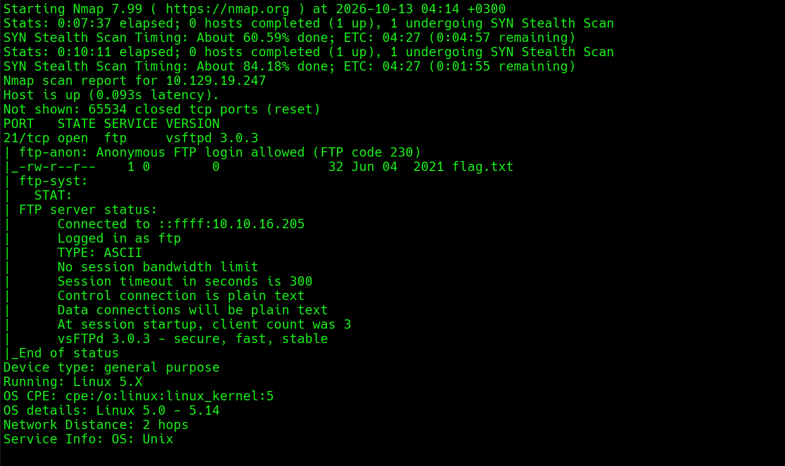
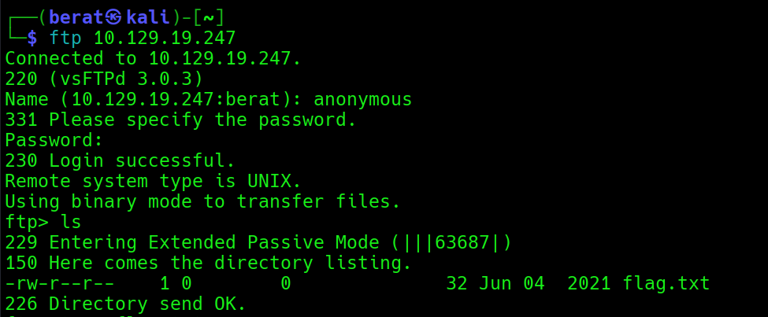
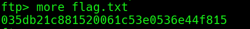

FAWN

Q1:What does the 3-letter acronym FTP stand for?

A1: file transfer protocol

Q2:Which port does the FTP service listen on usually?

A2: 21

Q3: FTP sends data in the clear, without any encryption. What acronym is
used for a later protocol designed to provide similar functionality to
FTP but securely, as an extension of the SSH protocol?

A3: sftp

Q4: What is the command we can use to send an ICMP echo request to test
our connection to the target?

A4: ping

Q5: From your scans, what version is FTP running on the target?

A5: vsftpd 3.0.3

Q6: From your scans, what OS type is running on the target?

A6: Unix

Q7: What is the command we need to run in order to display the 'ftp'
client help menu?

A7: ftp -?

Q8: What is username that is used over FTP when you want to log in
without having an account?

A8: anonymous

Q9: What is the response code we get for the FTP message 'Login
successful'?

A9: 230

Q10: There are a couple of commands we can use to list the files and
directories available on the FTP server. One is dir. What is the other
that is a common way to list files on a Linux system.

A10: ls

Q11: What is the command used to download the file we found on the FTP
server?

A11: get

(more ile direkt yazdırabiliriz bu arada)

Q12: (FLAG) : Submit the flag located on the FTP server.

A12: 035db21c881520061c53e0536e44f815

