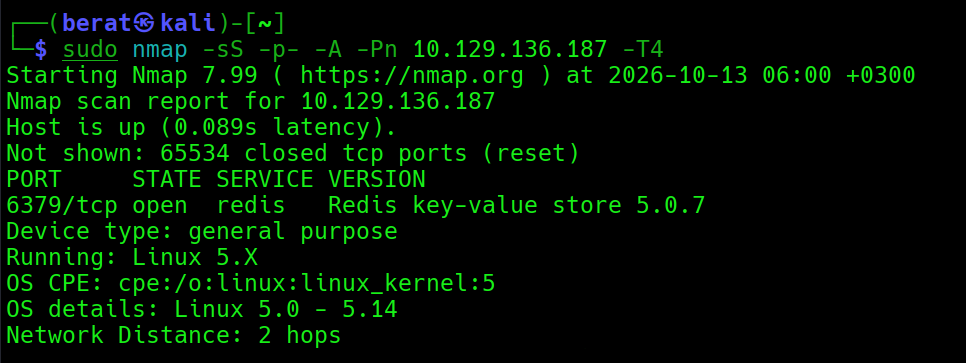
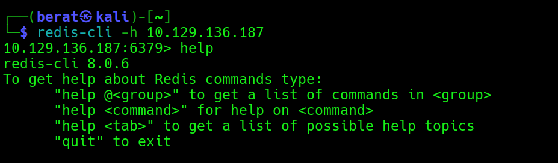
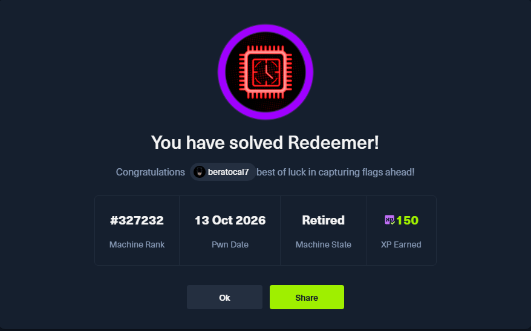

**Baþlý**

REDEEMER :

Q1: Which TCP port is open on the machine?

A1: 6379

Q2: Which service is running on the port that is open on the machine?

A2: redis

Q3: What type of database is Redis? Choose from the following options:
(i) In-memory Database, (ii) Traditional Database

A3: In-memory Database

Q4: Which command-line utility is used to interact with the Redis
server? Enter the program name you would enter into the terminal without
any arguments.

A4: redis-cli

Q5: Which flag is used with the Redis command-line utility to specify
the hostname?

A5: -h

Q6: Once connected to a Redis server, which command is used to obtain
the information and statistics about the Redis server?

A6: info

Q7: What is the version of the Redis server being used on the target
machine?

A7: 5.0.7

Q8: Which command is used to select the desired database in Redis?

A8: select

Q9: How many keys are present inside the database with index 0?

A9: 4

Q10: Which command is used to obtain all the keys in a database?

**Baþlý**

**A10: keys \***

**\## info keyspace : komutu ile tüm veritabanlarýndaki anahtarlarý
listeleriz.**

**\## select 0 : ile veritabanýný seçtik**

**\## keys : komutu ile anahtarlarý görüntüledik.**

**\## get flag : komutu ile flag anahtar deðerini okuduk
(görüntüledik.**

**Baþlý**

**Baþlý**

****

**Q11: (Flag) : Submit the flag located in the database.**

**Baþlý**

**A11: 03e1d2b376c37ab3f5319922053953eb**

****
