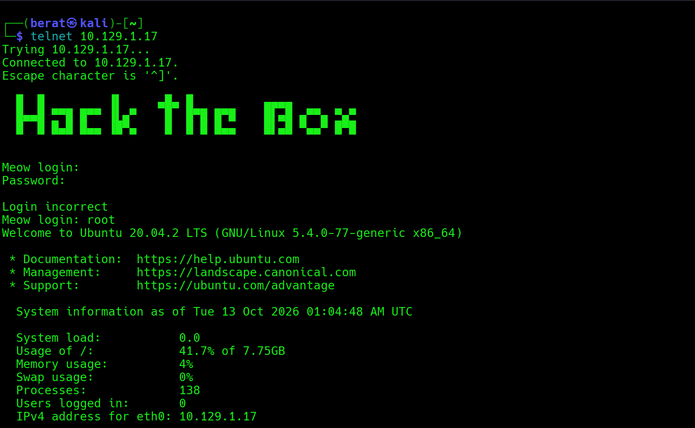
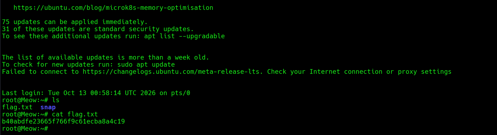

MEOW (Very Easy) (Linux)

Q1: In cybersecurity, isolated environments—like Pwnbox or the
vulnerable target machines—are often VMs. What does VM stand for?\
A1: Virtual Machine

Q2: What tool do we use to interact with the operating system in order
to issue commands via the command line, such as the one to start our VPN
connection? It's also known as a console or shell.\
A2: terminal

Q3: What service do we use to form our VPN connection into HTB labs?

A3: openvpn

Q4: What tool do we use to test our connection to the target with an
ICMP echo request?

A4: ping

Q5: What is the name of the most common tool for finding open ports on a
target?

A5: nmap

Q6: What service do we identify on port 23/tcp during our scans?

A6: telnet

Q7: What username is able to log into the target over telnet with a
blank password?

A7: root

Q8: Submit the flag located in root's home directory. (flag)

A8:b40abdfe23665f766f9c61ecba8a4c19

