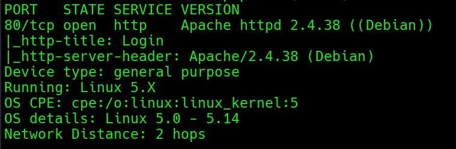
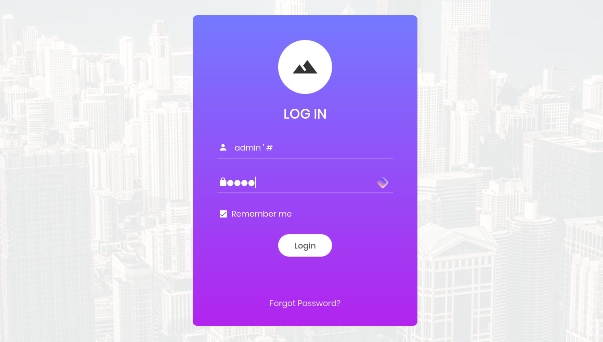
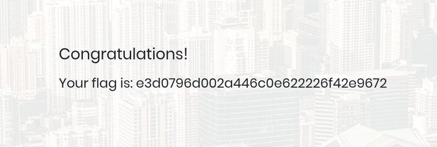
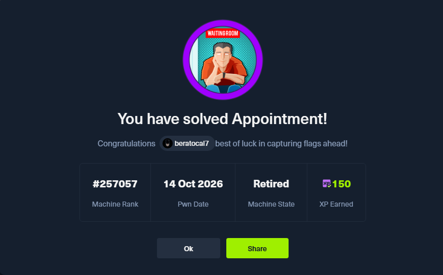

APPOİNTMENT :

Q1: What does the acronym SQL stand for?

A1: structured query language

Q2: What is one of the most common type of SQL vulnerabilities?

A2: sql injection

Q3: (TASK 3 yok)

A3:

Q4: What is the 2021 OWASP Top 10 classification for this vulnerability?

A4: A03:2021-Injection

Q5: What does Nmap report as the service and version that are running on
port 80 of the target?

A5: Apache httpd 2.4.38 ((Debian))

Q6: What is the standard port used for the HTTPS protocol?

A6: 443

Q7: What is a folder called in web-application terminology?

A7: directory

Q8: What is the HTTP response code that is returned for Not Found
errors?

A8: 404

Q9: Gobuster is one tool used to brute force directories on a webserver.
What switch do we use with Gobuster to specify we're looking to discover
directories, and not subdomains?

A9: dir

Q10: What single character can be used to comment out the rest of a line
in MySQL?

A10: \#

Q11: If user input is not handled carefully, it could be interpreted as
a comment. Use a comment to login as admin without knowing the password.
What is the first word on the webpage returned?

A11: **Congratulations**

login ekranında;

username : admin ‘ \#

password: sdfasd (önemli değil) atarak login olduk

Q12: (Flag) Submit the flag located in the webpage after bypassing the
login.

A12: **e3d0796d002a446c0e622226f42e9672**

